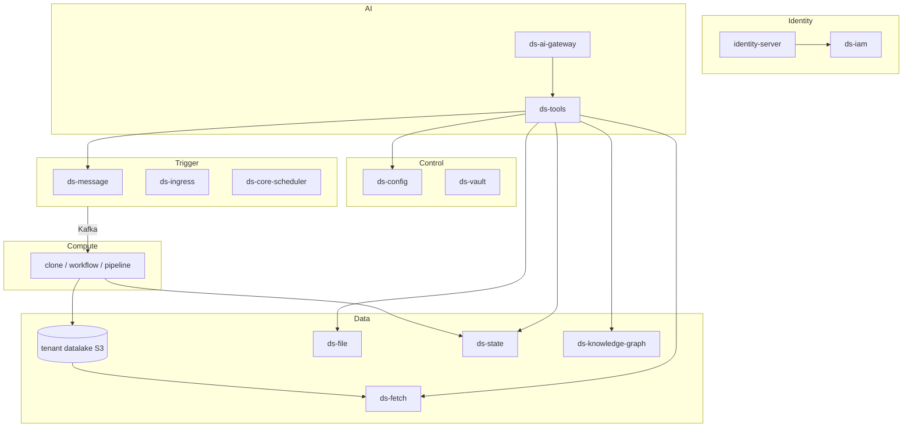

# 1. Platform overview

**AI Commons** (also: Commons, AIC, GraspDP, DaaS) is a platform for data, AI and
governance. Tenants connect source systems, land data in a per-tenant datalake,
run compute on it, and work with it through AI agents that use governed tools.

## The platform in numbers

| | What |
|---|---|
| **1 IdP** | `identity-server` — who you are |
| **12 services** | iam, vault, config, message, ingress, fetch, file, state, knowledge-graph, tools, ai-gateway, agent |
| **4 compute blocks** | `clone`, `workflow`, `pipeline`, `agent` (emerging) |
| **20 tools** | `ls cat find info grep schema write rm run status query text_to_sql preview plot inspect extract transcribe frames generate_image websearch` |

## Mental model

- **Identity** says who you are; **IAM** says what you may do.
- **Config** is the single source of truth: tenants, datasets, compute blocks,
  schedules, events, linked services, billing and AI policy.
- **Triggers** put a run request on Kafka. **Compute blocks** do the work.
- **Data** lives in the tenant bucket (bronze/silver/gold), in files, in state
  and in the knowledge graph.
- **AI** goes through the gateway, which enforces policy and calls tools.

## Environments and URLs

Every API follows one convention:

| Env | API | IdP |
|---|---|---|
| prod (default) | `https://grasp-daas.com/api/{service}/{version}` | `https://auth.grasp-daas.com` |
| dev (explicit) | `https://grasp-daas.com/api/{service}-dev/{version}` | `https://auth-dev.grasp-daas.com` |

Every service exposes `health-check/`, `version/` and `docs/` (OpenAPI).
Example: `https://grasp-daas.com/api/config/v3/docs/`.

## Tenants and the public tenant

- A **tenant** is the isolation boundary: its own bucket `ds-<tenant_uuid>-<env>`,
  its own config rows, secrets, files and graph.
- The **platform tenant** may mark rows `issuer: "public"`. Public rows are
  readable by every tenant. That is how shared content (playbooks, skills,
  courses, this book) reaches everyone.
- `public` is not a tenant you log into; it is a visibility flag.
