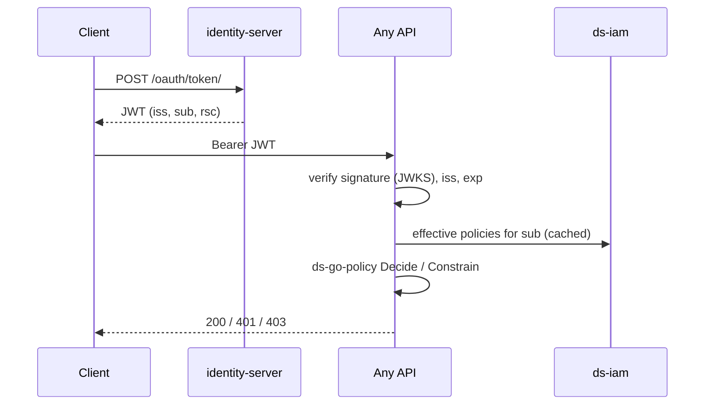
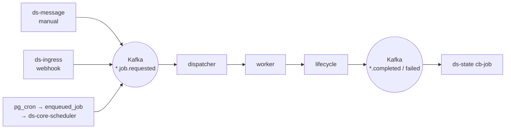
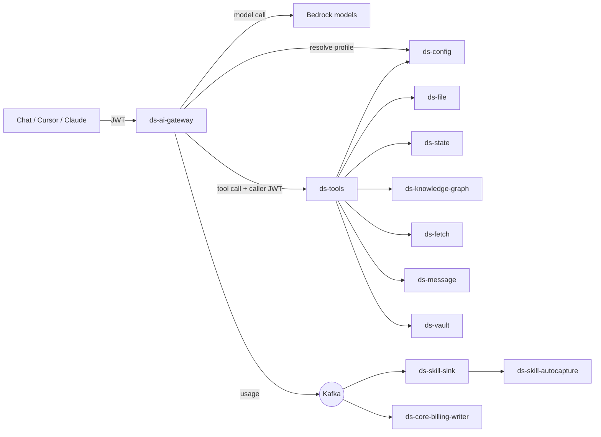

# 5. How it is wired together

Four flows explain the whole platform: **request**, **compute**, **AI**, **config change**.

## Edge

Internet → AWS ALB (`ds-infrastructure/network/alb`) → path-based routes
`/api/{service}[-dev]/{version}` → ECS services. `ds-tools` has no public route;
only the gateway's security group reaches it. Kubernetes (`ds-k8s-platform`)
hosts sandboxes and agent workloads.

## 1. Request flow (every API call)

## 2. Compute flow (every block run)

All three blocks follow one shape: **trigger → Kafka → dispatcher → worker → lifecycle → ds-state**.

| Block | Request topic | Dispatcher | Worker |
|---|---|---|---|
| clone | `ds.clone..job.requested.v1` | `ds-clone-dispatcher` | clone service (Fargate/Lambda) |
| workflow | `ds.workflow.pipeline.job.requested.v2` | `ds-workflow-dispatcher` | `ds-workflow-manager` |
| pipeline | `ds.pipeline..job.requested.v2` | `ds-pipeline-router` | bronze → silver → gold services |

The request event carries a **full snapshot** of the block's config (tasks,
datasets, linked services with secret refs, VPN). Workers do not call Config at runtime.

## 3. AI flow

- The gateway decides **which** models and tools; IAM decides **whether** each
  underlying call is allowed, using the caller's token.
- Conversations and trajectories are mined into candidate skills.

## 4. Config change flow

Write to ds-config → row committed → `resource.changed` on Kafka → consumers
refresh (gateway policy cache, billing writer, provisioning).

New tenant: identity event → `ds-data-partition-provision` → bucket
`ds-<tenant>-<env>`, SQS for the fetch indexer, default linked services, vault
secrets, IAM bootstrap.

## Kafka conventions

- Envelope and SDK: `ds-event-streams`, `ds-event-stream-go-sdk`.
- Topic shape: `<domain>.<area>.<entity>.<event>.v<N>`
  (e.g. `idp.identity..group.created.v1`, `ds.pipeline..job.completed.v2`).
- Producers own the schema; consumers must tolerate additive fields.

## Shared code

Go services start from `ds-go-echo-template` and share `ds-go-kit`,
`ds-go-echo-middleware` (auth), `ds-go-iam-middleware` + `ds-go-policy` (authz),
`ds-config-go-sdk`, `ds-vault-go-sdk`. Same conventions everywhere: Echo,
`/api/<svc>[-dev]/vN`, embedded OpenAPI, `BUILDING_MODE=dev|prod`.
