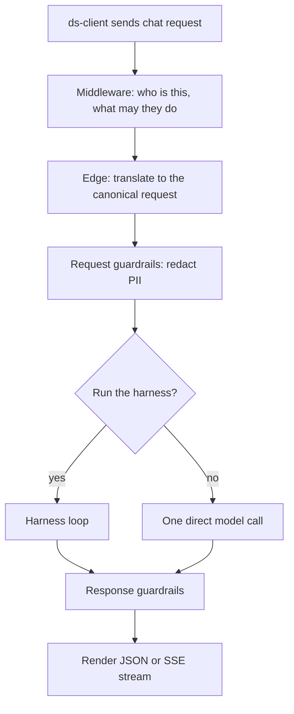

# Lesson 2 — One request, end to end

This lesson follows Kari's message from the moment she presses send to the
moment she sees the answer. Later lessons zoom into each step.

## The map



## Step 1 — The request arrives

ds-client posts Claude models in the Anthropic Messages format to
`/anthropic/v1/messages`, and other models in the OpenAI Chat Completions format
to `/openai/v1/chat/completions`; the gateway treats both as first-class. A
client switches to the gateway by changing one URL.

```http
POST /openai/v1/chat/completions
Authorization: Bearer <Kari's JWT>
X-Session-ID: <uuid>

{ "model": "<model-id>",
  "messages": [{ "role": "user",
    "content": "Find the September invoices for Globex in Tripletex and save a summary to our reports folder." }],
  "stream": true }
```

Three things to notice:

- **Identity comes from the token, never the body.** Tenant (Acme) and user
  (`kari.nordmann@acme.no`) are read from the verified JWT. A body cannot claim
  to be another tenant.
- **The session id is the client's.** It ties turns of one conversation together.
  It must be a UUID for the run to be recorded and rateable.
- **History is sent every time.** The gateway is stateless about chat history:
  the client resends the conversation on each request.

## Step 2 — Middleware

Before any model is called:

1. **Authentication.** The JWT is checked against cached signing keys. No call to
   the identity server per request.
2. **Policy.** The tenant's LLM profile is resolved from ds-config (cached):
   which models, which tools (the *allowlist*), mode, turn limit, rate limits,
   guardrails, governance tiers, and Acme's MCP servers.
3. **Rate limit.** One request is charged against Acme's requests-per-minute
   bucket in Valkey. Over the limit: `429` with `Retry-After`, and no model token
   is spent.

## Step 3 — Translate and guard

The edge turns the OpenAI body into one internal shape, the *canonical request*.
From here on, nothing cares which wire format the client used.

If Acme has `pii_redaction` on, request guardrails mask emails, card numbers and
IBANs in what the model will see. "Send it to ola@acme.no" reaches the model as
"Send it to [REDACTED_EMAIL]".

## Step 4 — Harness or not?

The harness runs unless one of these is true:

| Condition | Why bypass |
|---|---|
| Mode is `fast` | The tenant chose pure generation, lowest latency. |
| `tool_choice: "none"` | The caller asked for "a model, not an agent". |
| The client sent its own `tools[]` | Classic function calling: the client runs its tools. |
| The model cannot call tools | Nothing to offer it. |

Kari's request has none of these, so the harness runs.

## Step 5 — The harness loop

The loop is simple at heart: ask the model, run any tools it asks for, repeat.

**Before turn one**, the harness *seeds* the working set. It loads the tools
Acme's policy grants and, if they clearly beat everything else for Kari's words,
up to two proven skills (lesson 4).

**Each turn:**

1. **Compose.** System prompt + history + the tools the model may see: the
   meta-tools (`discover_tools`, `expand_tool`, `recall`) and the working set.
2. **Call the model.** Text streams to Kari as it arrives.
3. **Look at tool calls.** No tool calls means the model is done.
4. **Run each call**, by kind:
   - a **meta-tool** (discover, expand, recall) is handled inside the gateway;
   - a **skill** is expanded and its steps run one by one;
   - a **real tool** goes through the gates (lesson 7), then to ds-tools or to
     the MCP server.
5. **Append results** (redacted) to history and go again.

The loop stops when the model answers without tool calls, or when the turn limit
is hit.

Kari's run might look like this:

```
turn 1  model -> discover_tools("search invoices by customer and month")
        gateway -> [mcp_tripletex__search_invoices 0.91, query 0.55, ...]
turn 2  model -> expand_tool(tk_...)            loads search_invoices
turn 3  model -> mcp_tripletex__search_invoices({customer:"Globex", from:"2026-09-01", to:"2026-09-30"})
        gateway -> IAM check, rate limit, call Tripletex -> 14 invoices
turn 4  model -> write({path:"/reports/globex-2026-09.md", content:"..."})
        gateway -> write is P2 for Acme: ask Kari to confirm   (lesson 7)
```

## Step 6 — When the loop ends

Several things happen on the way out, none of which delay Kari:

- **Classification.** The run's tool calls are labelled `user_kept`,
  `user_redid` or `loop_detected` for the ranker (lesson 6).
- **Summary.** A short summary of the session is saved so `recall` can find it
  later (lesson 5).
- **Feedback reference.** When a person is chatting, the response carries
  `x_ds_feedback` so ds-client can show thumbs up/down, listing any skill runs
  the rating applies to (lesson 6).
- **Conversation record.** The new messages are published to Kafka for
  ds-skill-sink (lesson 6).

Response guardrails mask the answer the same way the request was masked, and the
edge renders it back in the format it came in, streamed as SSE.

## What Kari never sees

The meta-tool calls, the ds-tools calls and the skill steps are *server-side*:
they never appear as `tool_calls` in her response. She sees text, and possibly a
confirmation question. Only tools the client itself supplied are surfaced as
`tool_calls`, because only then is the client meant to run them.

## Check yourself

1. Where do tenant and user come from, and why not from the body?
2. Kari's client sends `tool_choice: "none"`. What happens?
3. Which of these does the harness handle without calling ds-tools:
   `discover_tools`, `query`, `expand_tool`, `write`?

<details><summary>Answers</summary>

1. From the verified JWT, so a caller cannot impersonate another tenant or user.
2. The harness is bypassed: one direct model call with no tools.
3. `discover_tools` and `expand_tool`; they are meta-tools. `query` and `write`
   are real tools and go through the gates to ds-tools.

</details>

Next: Lesson 3 — Tools and discovery
