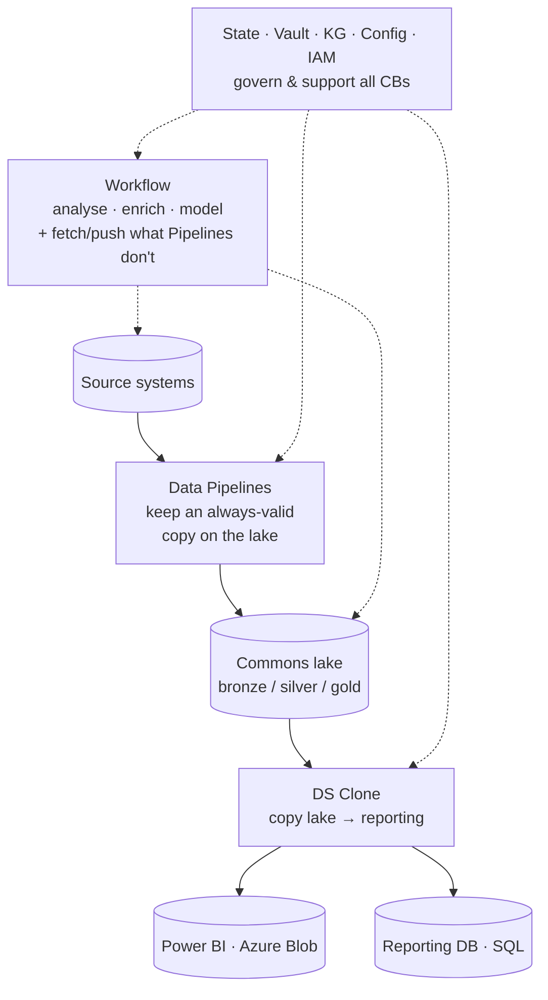

## The three compute blocks

On top of the services sit three compute blocks. This is the part a BI team uses most.

**Data Pipelines**
Fetch and keep an always-valid copy of your system data on the Commons lake (bronze/silver/gold). The lake stays current — this is your certified source of truth.

**DS Clone — Data Sync**
Copy from the lake out to where reporting needs it: Power BI (Azure Blob) or a reporting database (SQL). Runs on demand, on schedules, and on webhook events. The handy A→B copy.

**Workflow**
No-code / low-code ETL that works *on* lake data — analyse, enrich, model — or fetches data Pipelines don't cover and pushes data wherever it's needed.

State, Vault and the other services connect to all three.

> **Rule of thumb:** Pipelines *keep the lake valid*, Clone *copies lake → reporting*, Workflow *does the specific work — building data from data, agentic and model operations*.

<!-- ds-course-column:2 type=markdown -->

## How it fits together

Pipelines keep the lake valid; Clone copies it out to Power BI or your reporting database; Workflow works on lake data — or reaches systems Pipelines don't cover. State, Vault and the other services connect to every compute block.
