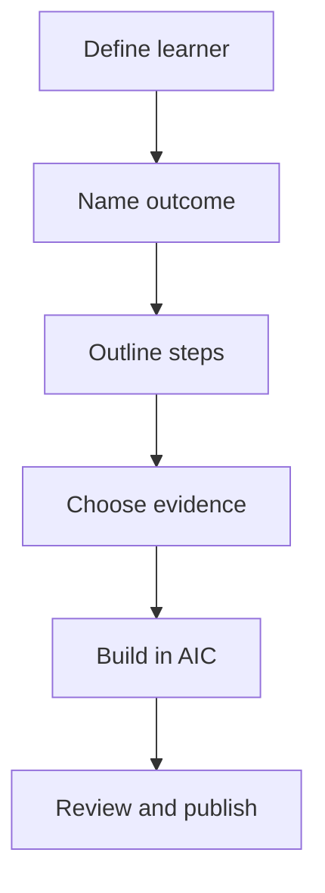

## Start with one outcome

Write this sentence before creating any content:

> After this course, **[audience]** can **[action]** in **[context]** without **[common risk]**.

**Example**

After this course, a course author can build and publish an AIC course with readable Markdown and Mermaid diagrams without losing control of layout or access.

### Ask three questions

1. Who is the learner?
2. What should they be able to do?
3. What evidence will show they can do it?

<!-- ds-course-column:2 type=markdown -->

