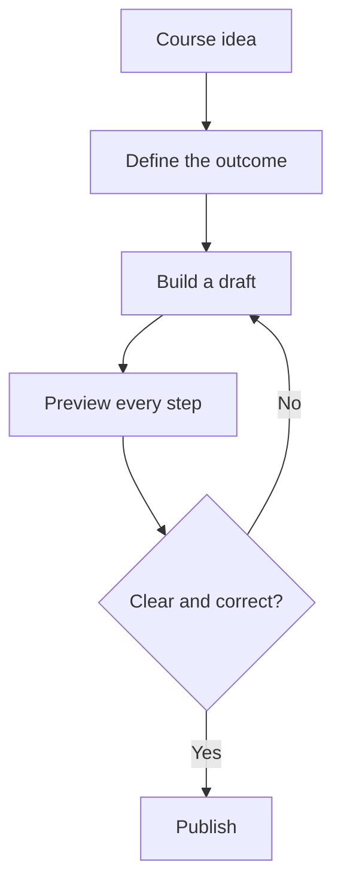

## The pattern

Create a fenced code block, set its language to **mermaid**, and place the diagram source inside.

```text
flowchart LR
    Draft --> Review
    Review --> Publish
```

AIC detects the Mermaid block and renders it automatically in the editor, course player, and PDF export.

### Keep the source maintainable

- one statement per line;
- short, meaningful node labels;
- stable IDs for nodes you reconnect;
- indentation for readability.

<!-- ds-course-column:2 type=markdown -->


