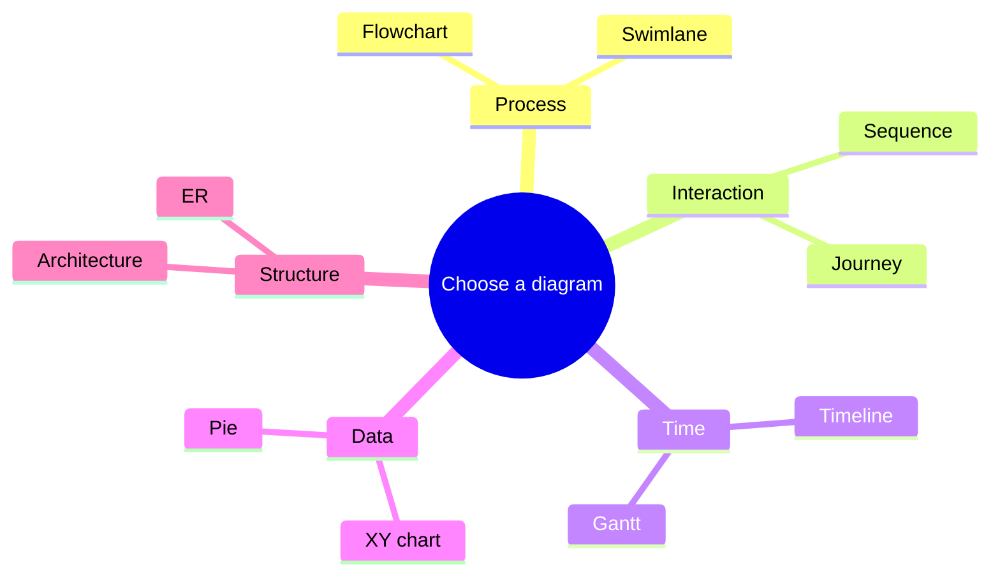

## Start with the learner's question

| The learner needs to understand… | Start with… |
|---|---|
| A process or decision | Flowchart |
| Who talks to whom | Sequence |
| Responsibility across teams | Swimlane |
| Work across dates | Timeline or Gantt |
| System boundaries | Architecture or C4 |
| Data relationships | ER diagram |
| Relative values or trends | XY, pie, radar, or treemap |
| Causes of a problem | Ishikawa |
| Strategic evolution | Wardley |

> A diagram is successful when it removes explanation — not when it displays every available fact.

<!-- ds-course-column:2 type=markdown -->

