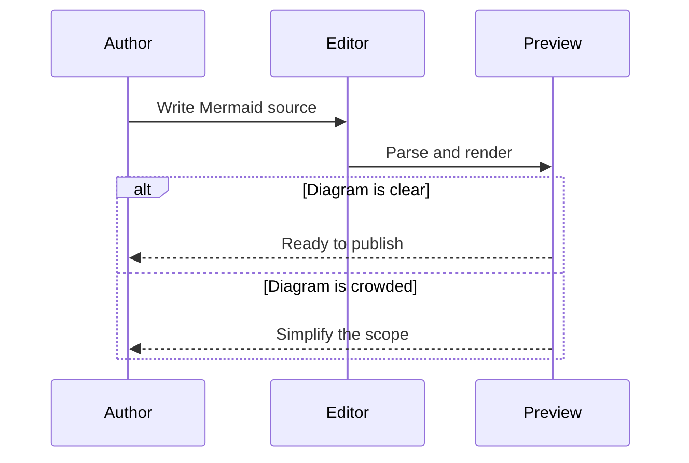

## Source you can maintain

```text
sequenceDiagram
    participant A as Author
    participant E as Editor
    participant P as Preview
    A->>E: Write Mermaid source
    E->>P: Parse and render
    alt Diagram is clear
        P-->>A: Ready to publish
    else Diagram is crowded
        P-->>A: Simplify the scope
    end
```

Use aliases to keep participant IDs short while showing readable labels.

<!-- ds-course-column:2 type=markdown -->


