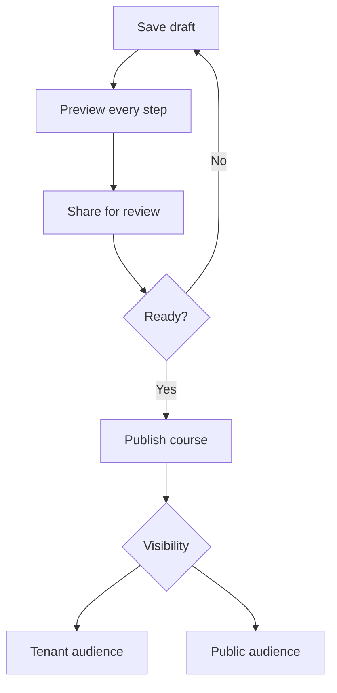

## Use the lifecycle deliberately

1. **Save draft** while content or layout is incomplete.
2. **Preview** every step in the course player.
3. **Share** with a reviewer when feedback is needed.
4. **Publish** only when the complete course is ready.

| Access | What it allows |
|---|---|
| View | Open and complete the course |
| Edit | Change and manage the course |
| Public | Make the course available in every tenant (platform tenant only) |

The creator remains an owner. Share only with the people or wildcard audience that actually needs access.

<!-- ds-course-column:2 type=markdown -->

