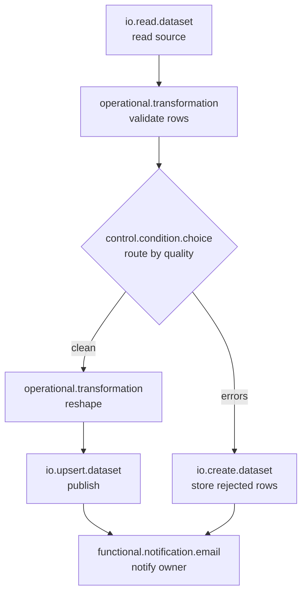

<!-- ds-course-column:2 type=markdown -->

# What a workflow actually is

Start with the smaller word.

A **task** is one unit of work. Read a dataset. Join two frames. Drop some columns. Call an AI model. Send an email. One task, one clear outcome.

A **workflow** is a set of tasks plus the rules that connect them. Concretely, on this platform it is:

1. A **workflow config** — the container. It holds settings that apply to the whole run: which compute engine to use, where to execute, how many times to retry, and any variables the tasks can read.
2. A set of **tasks** — each one belonging to that workflow, each with a `type` drawn from a fixed registry, and each with its own `settings`.
3. A set of **dependency edges** — rows that say "this task waits on that task".

Nothing here needs to be executed to be read, validated, or drawn. That is deliberate.

## The graph it describes

Tasks are not a flat list — they form a **directed acyclic graph**. Tasks are the nodes; dependency edges decide which task waits on which, and `bindings` supply each task with the output of earlier ones.

The diagram beside this is a real shape: read, validate, branch on the outcome, converge on a notification. Three things worth noticing:

- **Fan-in.** The notification waits for whichever branch ran.
- **Branching.** A choice task selects which route continues.
- **Acyclic.** Edges never loop back on themselves.

## Two questions to answer before running

Every task in a workflow answers two separate questions, and it pays to keep them apart from your very first build:

- **What data do I receive?** — answered by `bindings`.
- **Am I allowed to run at all?** — answered by `condition`, which looks at how the tasks it depends on finished (`all-success`, `any-failure`, `always`, and so on).

A task whose `condition` is not met is skipped. A task with no bindings receives no upstream data. Those are different failure modes with different fixes, and confusing them is the most common way a first workflow goes quietly wrong.

> Get `condition` and `bindings` straight, and the rest of this course is detail.
