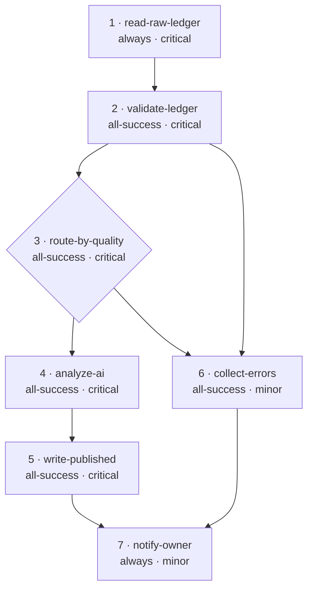

## The graph you just planned

### What to look for

**The spine is all `critical`.** Tasks 1 through 5 are the reason the workflow exists. Any of them failing means the run failed.

**Tasks 4 and 6 take their data from task 2, but are gated by task 3.** Task 3 is a choice: it selects which branch runs but passes no data on. Binding a branch to the choice instead of task 2 is a common slip, and the branch then fails on a missing input.

**Task 7 is the only fan-in.** It has two upstream tasks on mutually exclusive paths — one is always skipped — which is precisely why its condition is `always`. Anything stricter and the failure path goes unreported.

**No arrow returns.** Every edge moves forward. If you ever find yourself drawing one that loops back, you want two tasks, not a cycle.

> Draw this before you build. Diagrams surface a mis-wired branch in seconds; a run takes minutes and tells you less.

<!-- ds-course-column:2 type=markdown -->

# Step 7 — A worked example

Let's build the thing described in the diagram: read yesterday's ledger, validate it, analyze it with AI, report on the findings, and tell someone what happened either way.

## Plan it before you build it

Write the tasks as sentences first. If a sentence needs an "and", split it.

1. Read the raw ledger dataset.
2. Validate the rows against expectations.
3. Decide which route continues: valid or invalid data.
4. Analyze the valid rows with AI.
5. Write them to the target dataset.
6. Collect the invalid rows into an error report.
7. Tell the owner the outcome.

Seven sentences, seven tasks. This costs five minutes and saves an hour.

## Then assign the three fields

Go through the list and decide `condition`, `severity`, and `bindings` for each. Doing this as a pass — rather than task by task while building — is what catches the gaps.

| # | Task | `condition` | `severity` | Receives |
| --- | --- | --- | --- | --- |
| 1 | `read-raw-ledger` | `always` | `critical` | nothing (reads by id) |
| 2 | `validate-ledger` | `all-success` | `critical` | 1 |
| 3 | `route-by-quality` | `all-success` | `critical` | 2 |
| 4 | `analyze-ai` | `all-success` | `critical` | 2 |
| 5 | `write-published` | `all-success` | `critical` | 4 |
| 6 | `collect-errors` | `all-success` | `minor` | 2 |
| 7 | `notify-owner` | `always` | `minor` | 5, 6 |

## Why those choices

**Task 1 is `always`** because nothing precedes it. Leaving it on `all-success` works, but `always` states the intent.

**Tasks 2–5 are `critical` and `all-success`** — this is the spine. If validation fails, publishing must not happen. The cascade of skips is exactly what you want.

**Task 4 needs a dataset task** — there is no built-in AI task type, and Python tasks have no network. Point a dataset task (for example `io.create.dataset`) at an HTTP linked service that calls your model's API.

**Task 6 is `all-success` and `minor`** — it runs only when the choice selects the invalid route, and a failure to *write the report* should not itself sink the run. Make it a write (or an email with the rows attached), not the collect-errors type, which currently always returns an empty frame.

**Task 7 is `always` and `minor`** — the single most important line in the table. Whatever happened, someone hears. And a bounced email never turns a good run red.

> Notice that the interesting decisions were all made on paper. By the time you write JSON, you are transcribing, not designing.
