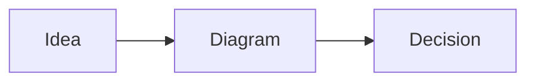

## The Markdown contract

Wrap Mermaid source in a fenced code block:

~~~text

~~~

The language name must be exactly `mermaid`. The first line inside the fence selects the diagram family.

### Editing loop

1. click the Markdown preview;
2. edit the source;
3. leave the editor to render;
4. fix any fallback source shown after a parse error.

<!-- ds-course-column:2 type=markdown -->

## Use the visualization controls

Every rendered chart includes:

- **zoom in** and **zoom out**;
- **fit** to restore the full diagram;
- **fullscreen** for dense models;
- **source** to inspect the Mermaid text.

### Reliable authoring habits

- begin with the smallest valid chart;
- add one concept at a time;
- keep identifiers stable and labels human;
- quote labels containing punctuation;
- inspect both light and dark mode;
- split a diagram before it becomes a poster.

> A valid diagram can still be a poor explanation. Rendering is only the first quality gate.
