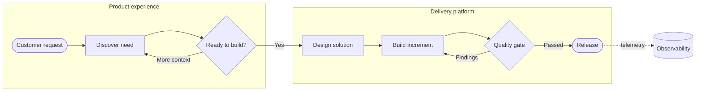

## Flowchart: processes, decisions, and hand-offs

**Atlas example 1 of 44**

Use a flowchart when the reader needs to follow work from an input to an outcome and see where decisions change the path.

### Core Mermaid elements
- flowchart LR or flowchart TD sets the reading direction.
- [Rectangle], {Decision}, ([Terminal]), and [(Store)] create distinct node shapes.
- --> creates a connection, -->|label| adds meaning, and -.-> shows a secondary or asynchronous link.
- subgraph groups related steps into a named boundary.

### Build it well
1. Choose one reading direction before adding nodes.
2. Name nodes with short actions, not paragraphs.
3. Label every branch leaving a decision.
4. Use subgraphs only for real ownership or system boundaries.

> A flowchart should answer what happens next, not document every implementation detail.

<!-- ds-course-column:2 type=markdown -->

## Working example

Use the chart controls to zoom, fit, open fullscreen, or inspect the exact source.
