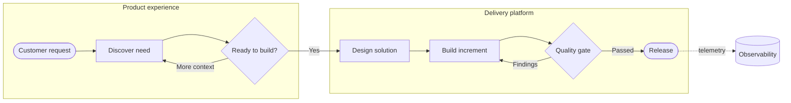

## Mermaid source

```text
flowchart LR
  subgraph Experience[Product experience]
    Request([Customer request]) --> Discover[Discover need]
    Discover --> Decision{Ready to build?}
  end
  subgraph Delivery[Delivery platform]
    Design[Design solution] --> Build[Build increment]
    Build --> Verify{Quality gate}
    Verify -->|Passed| Release([Release])
    Verify -->|Findings| Build
  end
  Decision -->|Yes| Design
  Decision -->|More context| Discover
  Release -. telemetry .-> Observe[(Observability)]
```

Change one line at a time, then compare the rendered result on the right.

<!-- ds-course-column:2 type=markdown -->

## Rendered result



Use zoom, fit, fullscreen, and source controls when the diagram is dense.
