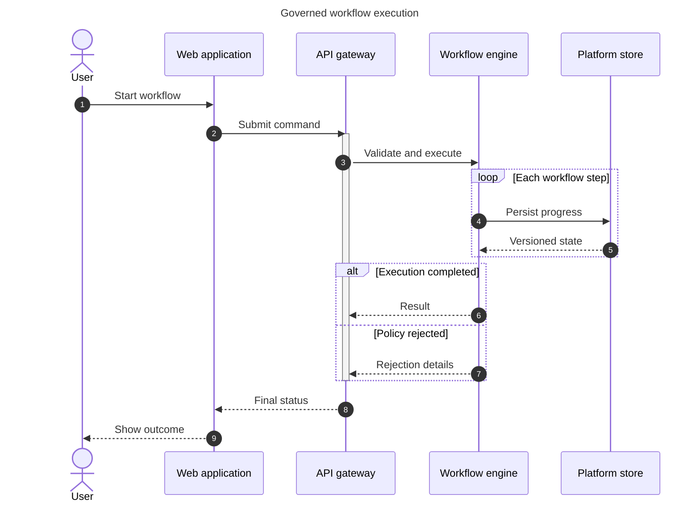

## Sequence diagram: messages over time

**Atlas example 2 of 44**

Use a sequence diagram to explain how people, applications, and services collaborate during one scenario.

### Core Mermaid elements
- sequenceDiagram starts the diagram; title and autonumber improve orientation.
- actor represents a person; participant represents a system or service.
- ->> is a solid request, -->> a dashed response, and activate/deactivate shows work in progress.
- loop, alt, else, and end describe repeated and conditional interactions.

### Build it well
1. Keep participants in a stable left-to-right order.
2. Describe messages as actions or payloads.
3. Show one successful or failure scenario per fragment.
4. End with the outcome visible to the initiating actor.

> Sequence diagrams are strongest when they tell one concrete story.

<!-- ds-course-column:2 type=markdown -->

## Working example

Use the chart controls to zoom, fit, open fullscreen, or inspect the exact source.
