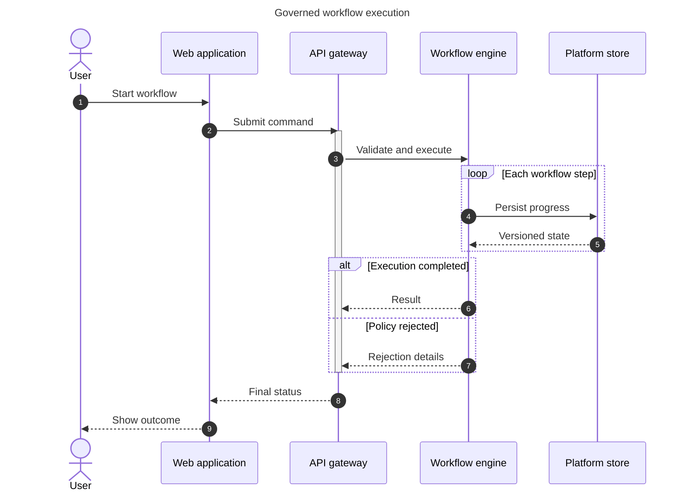

## Mermaid source

```text
sequenceDiagram
  title Governed workflow execution
  autonumber
  actor User
  participant Web as Web application
  participant API as API gateway
  participant Engine as Workflow engine
  participant Store as Platform store
  User->>Web: Start workflow
  Web->>API: Submit command
  activate API
  API->>Engine: Validate and execute
  loop Each workflow step
    Engine->>Store: Persist progress
    Store-->>Engine: Versioned state
  end
  alt Execution completed
    Engine-->>API: Result
  else Policy rejected
    Engine-->>API: Rejection details
  end
  deactivate API
  API-->>Web: Final status
  Web-->>User: Show outcome
```

Change one line at a time, then compare the rendered result on the right.

<!-- ds-course-column:2 type=markdown -->

## Rendered result



Use zoom, fit, fullscreen, and source controls when the diagram is dense.
