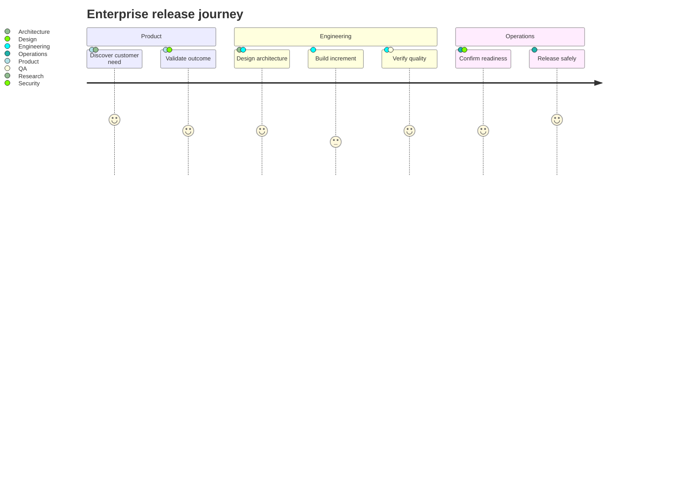

## User journey: experience across stages

**Atlas example 3 of 44**

Use a journey chart to show tasks, responsible roles, and how good or difficult each moment feels.

### Core Mermaid elements
- journey starts the chart and title names the experience.
- section creates a phase such as Product, Engineering, or Operations.
- Task: score: actors defines one moment; scores run from 1 to 5.
- Multiple actors are separated by commas.

### Build it well
1. Organize tasks into a small number of meaningful phases.
2. Use consistent score criteria across the journey.
3. Name the role that experiences or owns each task.
4. Look for low scores and abrupt changes between adjacent tasks.

> A journey chart is an experience diagnostic, not a project schedule.

<!-- ds-course-column:2 type=markdown -->

## Working example

Use the chart controls to zoom, fit, open fullscreen, or inspect the exact source.
