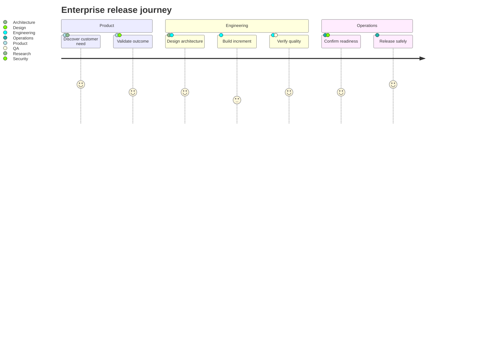

## Mermaid source

```text
journey
  title Enterprise release journey
  section Product
    Discover customer need: 5: Product, Research
    Validate outcome: 4: Product, Design
  section Engineering
    Design architecture: 4: Architecture, Engineering
    Build increment: 3: Engineering
    Verify quality: 4: Engineering, QA
  section Operations
    Confirm readiness: 4: Operations, Security
    Release safely: 5: Operations
```

Change one line at a time, then compare the rendered result on the right.

<!-- ds-course-column:2 type=markdown -->

## Rendered result



Use zoom, fit, fullscreen, and source controls when the diagram is dense.
