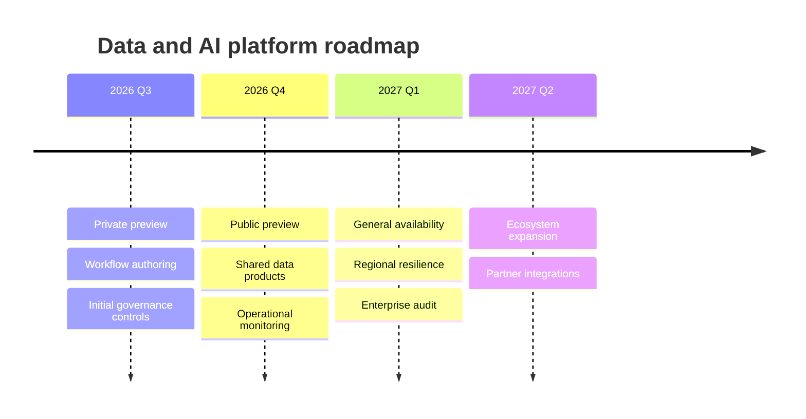

## Timeline: milestones and chronological change

**Atlas example 4 of 44**

Use a timeline when order and historical progression matter more than exact task durations.

### Core Mermaid elements
- timeline starts the diagram; title adds context.
- A period followed by : introduces a milestone.
- Additional indented : lines add details to the same period.
- Labels can be dates, quarters, releases, or named eras.

### Build it well
1. Choose a consistent time scale.
2. Keep milestone labels short and outcome-focused.
3. Limit detail to events that explain change.
4. Use Gantt instead when duration and dependencies are essential.

> A timeline explains how something evolved; it does not manage delivery.

<!-- ds-course-column:2 type=markdown -->

## Working example

Use the chart controls to zoom, fit, open fullscreen, or inspect the exact source.
