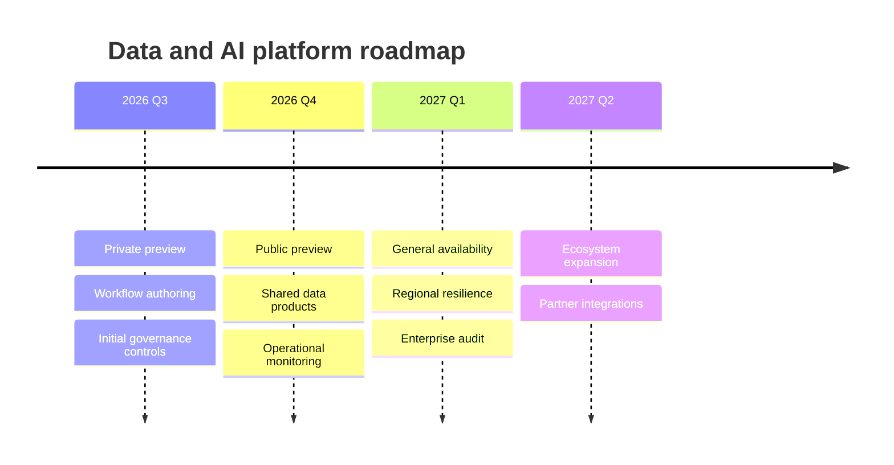

## Mermaid source

```text
timeline
  title Data and AI platform roadmap
  2026 Q3 : Private preview
          : Workflow authoring
          : Initial governance controls
  2026 Q4 : Public preview
          : Shared data products
          : Operational monitoring
  2027 Q1 : General availability
          : Regional resilience
          : Enterprise audit
  2027 Q2 : Ecosystem expansion
          : Partner integrations
```

Change one line at a time, then compare the rendered result on the right.

<!-- ds-course-column:2 type=markdown -->

## Rendered result



Use zoom, fit, fullscreen, and source controls when the diagram is dense.
