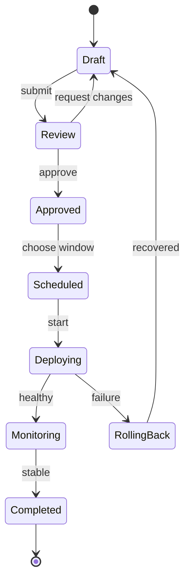

## State diagram: lifecycle and transitions

**Atlas example 5 of 44**

Use a state diagram to define the valid lifecycle of an object and the events that move it between states.

### Core Mermaid elements
- stateDiagram-v2 selects the current state syntax.
- [*] is the start or terminal marker.
- Draft --> Review: submit defines source, target, and triggering event.
- State names should represent stable conditions, not actions.

### Build it well
1. List the valid states before drawing arrows.
2. Name every business-triggered transition.
3. Include rejection, retry, and terminal paths.
4. Check that no state is accidentally unreachable.

> If a node is an action, it probably belongs in a flowchart instead.

<!-- ds-course-column:2 type=markdown -->

## Working example

Use the chart controls to zoom, fit, open fullscreen, or inspect the exact source.
