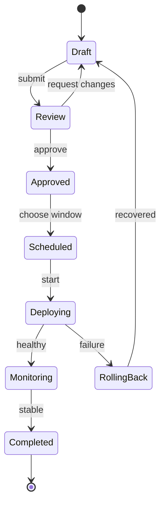

## Mermaid source

```text
stateDiagram-v2
  [*] --> Draft
  Draft --> Review: submit
  Review --> Draft: request changes
  Review --> Approved: approve
  Approved --> Scheduled: choose window
  Scheduled --> Deploying: start
  Deploying --> Monitoring: healthy
  Deploying --> RollingBack: failure
  RollingBack --> Draft: recovered
  Monitoring --> Completed: stable
  Completed --> [*]
```

Change one line at a time, then compare the rendered result on the right.

<!-- ds-course-column:2 type=markdown -->

## Rendered result



Use zoom, fit, fullscreen, and source controls when the diagram is dense.
