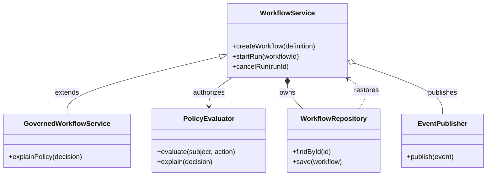

## Class diagram: structure and relationships

**Atlas example 6 of 44**

Use a class diagram to communicate types, responsibilities, members, inheritance, and ownership in a software model.

### Core Mermaid elements
- classDiagram starts the model; class Name { ... } declares members.
- + public, - private, and # protected describe visibility.
- <|-- inheritance, *-- composition, o-- aggregation, and ..> dependency express different relationships.
- A relationship label explains why two types are connected.

### Build it well
1. Show only members relevant to the discussion.
2. Use composition only when lifecycle ownership is real.
3. Label ambiguous dependencies.
4. Split large domain models into focused diagrams.

> A class diagram should explain design decisions, not mirror every line of source code.

<!-- ds-course-column:2 type=markdown -->

## Working example

Use the chart controls to zoom, fit, open fullscreen, or inspect the exact source.
