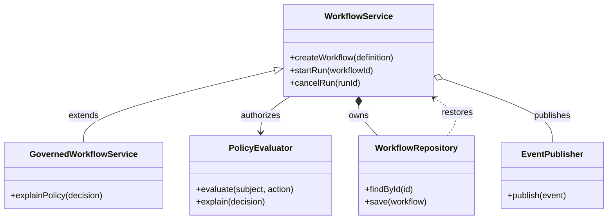

## Mermaid source

```text
classDiagram
  class WorkflowService {
    +createWorkflow(definition)
    +startRun(workflowId)
    +cancelRun(runId)
  }
  class PolicyEvaluator {
    +evaluate(subject, action)
    +explain(decision)
  }
  class WorkflowRepository {
    +findById(id)
    +save(workflow)
  }
  class EventPublisher {
    +publish(event)
  }
  class GovernedWorkflowService {
    +explainPolicy(decision)
  }
  WorkflowService <|-- GovernedWorkflowService : extends
  WorkflowService --> PolicyEvaluator : authorizes
  WorkflowService *-- WorkflowRepository : owns
  WorkflowService o-- EventPublisher : publishes
  WorkflowRepository ..> WorkflowService : restores
```

Change one line at a time, then compare the rendered result on the right.

<!-- ds-course-column:2 type=markdown -->

## Rendered result



Use zoom, fit, fullscreen, and source controls when the diagram is dense.
