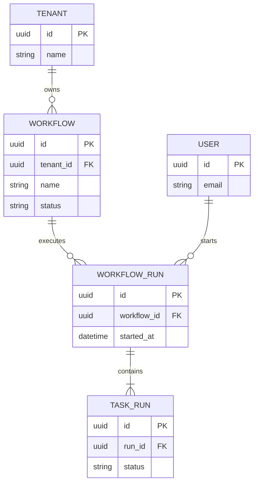

## Entity relationship diagram: data structure

**Atlas example 7 of 44**

Use an ER diagram to show entities, important attributes, and the cardinality of persisted relationships.

### Core Mermaid elements
- erDiagram starts the schema.
- ENTITY { type attribute PK } lists fields and key markers such as PK and FK.
- || means exactly one, o{ zero or many, and |{ one or many.
- ENTITY_A ||--o{ ENTITY_B : label describes the relationship.

### Build it well
1. Begin with the business entities and their identifiers.
2. Add only attributes needed to understand the relationship.
3. Verify both sides of every cardinality.
4. Use relationship labels as clear verbs.

> ER diagrams model stored relationships; sequence diagrams model runtime calls.

<!-- ds-course-column:2 type=markdown -->

## Working example

Use the chart controls to zoom, fit, open fullscreen, or inspect the exact source.
