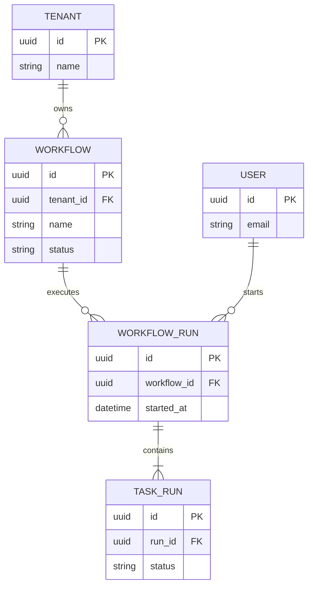

## Mermaid source

```text
erDiagram
  TENANT ||--o{ WORKFLOW : owns
  WORKFLOW ||--o{ WORKFLOW_RUN : executes
  WORKFLOW_RUN ||--|{ TASK_RUN : contains
  USER ||--o{ WORKFLOW_RUN : starts
  TENANT {
    uuid id PK
    string name
  }
  WORKFLOW {
    uuid id PK
    uuid tenant_id FK
    string name
    string status
  }
  WORKFLOW_RUN {
    uuid id PK
    uuid workflow_id FK
    datetime started_at
  }
  TASK_RUN {
    uuid id PK
    uuid run_id FK
    string status
  }
  USER {
    uuid id PK
    string email
  }
```

Change one line at a time, then compare the rendered result on the right.

<!-- ds-course-column:2 type=markdown -->

## Rendered result



Use zoom, fit, fullscreen, and source controls when the diagram is dense.
