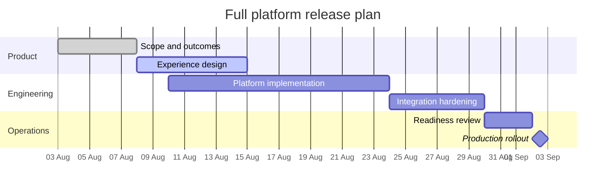

## Gantt chart: schedule and dependencies

**Atlas example 8 of 44**

Use Gantt when the reader needs start dates, durations, status, sections, and dependency order.

### Core Mermaid elements
- gantt starts the chart; title, dateFormat, and axisFormat configure it.
- section groups workstreams.
- Task :status, id, start, duration defines a bar.
- after taskId creates a dependency; milestone creates a milestone.

### Build it well
1. Give every depended-on task a stable id.
2. Separate workstreams with sections.
3. Mark done and active work honestly.
4. Avoid turning a strategic roadmap into a false-precision schedule.

> Use Timeline for narrative milestones and Gantt for executable planning.

<!-- ds-course-column:2 type=markdown -->

## Working example

Use the chart controls to zoom, fit, open fullscreen, or inspect the exact source.
