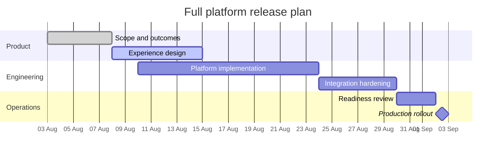

## Mermaid source

```text
gantt
  title Full platform release plan
  dateFormat YYYY-MM-DD
  axisFormat %d %b
  section Product
  Scope and outcomes       :done, scope, 2026-08-03, 5d
  Experience design        :active, design, after scope, 7d
  section Engineering
  Platform implementation  :build, 2026-08-10, 14d
  Integration hardening    :verify, after build, 6d
  section Operations
  Readiness review         :ready, after verify, 3d
  Production rollout       :milestone, release, after ready, 1d
```

Change one line at a time, then compare the rendered result on the right.

<!-- ds-course-column:2 type=markdown -->

## Rendered result



Use zoom, fit, fullscreen, and source controls when the diagram is dense.
