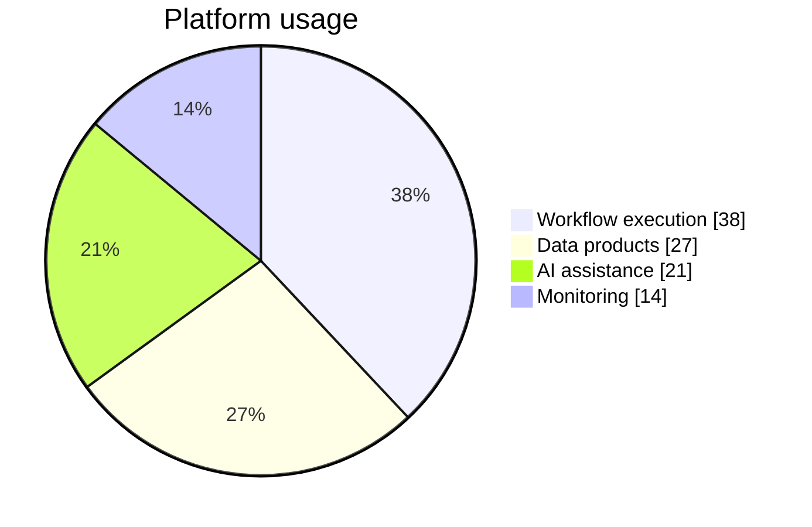

## Pie chart: composition of a whole

**Atlas example 9 of 44**

Use a pie chart for a small set of mutually exclusive categories that together form a meaningful whole.

### Core Mermaid elements
- pie starts the chart; showData prints values.
- title supplies context.
- "Category" : value defines each slice.
- Values may be counts or proportions; Mermaid calculates the share.

### Build it well
1. Keep the number of slices small.
2. Sort or group tiny categories when possible.
3. Use labels that explain the population being divided.
4. Prefer XY bars when precise comparison matters.

> A pie chart answers what makes up the whole, not how values changed over time.

<!-- ds-course-column:2 type=markdown -->

## Working example

Use the chart controls to zoom, fit, open fullscreen, or inspect the exact source.
