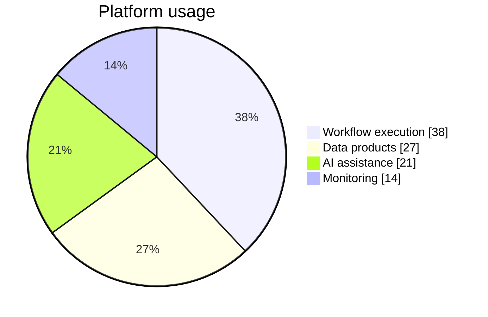

## Mermaid source

```text
pie showData
  title Platform usage
  "Workflow execution" : 38
  "Data products" : 27
  "AI assistance" : 21
  "Monitoring" : 14
```

Change one line at a time, then compare the rendered result on the right.

<!-- ds-course-column:2 type=markdown -->

## Rendered result



Use zoom, fit, fullscreen, and source controls when the diagram is dense.
