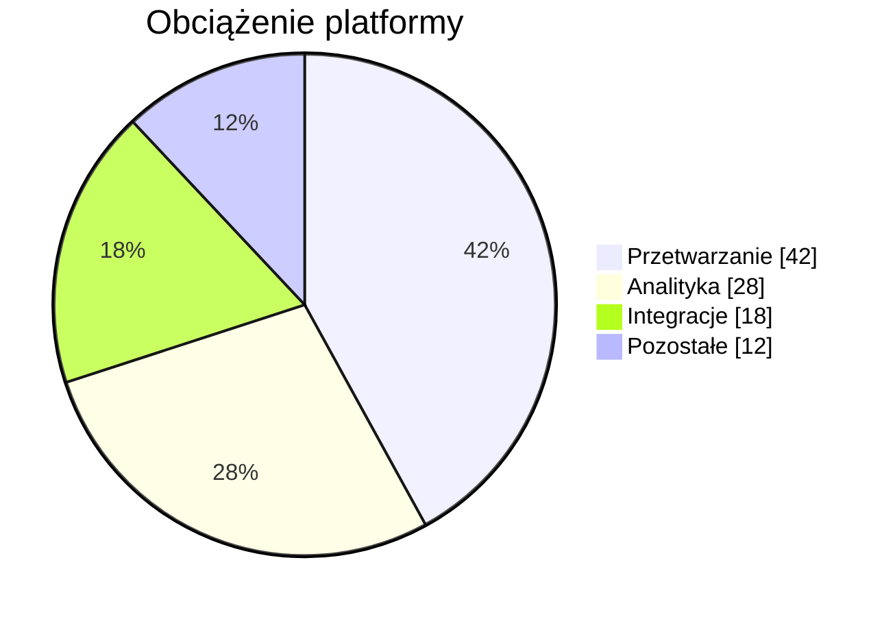

## Localized pie chart: readable labels in any language

**Atlas example 10 of 44**

Use the localized pie variant when the audience needs native-language labels, accents, and domain terminology.

### Core Mermaid elements
- The syntax is identical to pie.
- Quoted UTF-8 labels preserve spaces and localized characters.
- title can also be localized.
- showData keeps exact values visible beside visual proportions.

### Build it well
1. Write labels in the learner’s language.
2. Keep terminology consistent with the surrounding course.
3. Check long translations in both light and dark themes.
4. Do not mix languages unless the domain requires it.

> Localization changes meaning and label length, so always inspect the rendered chart.

<!-- ds-course-column:2 type=markdown -->

## Working example

Use the chart controls to zoom, fit, open fullscreen, or inspect the exact source.
