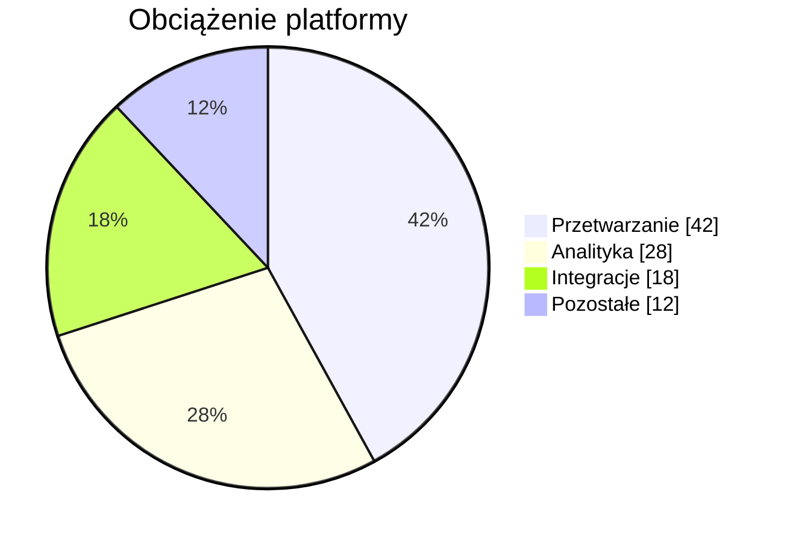

## Mermaid source

```text
pie showData
  title Obciążenie platformy
  "Przetwarzanie" : 42
  "Analityka" : 28
  "Integracje" : 18
  "Pozostałe" : 12
```

Change one line at a time, then compare the rendered result on the right.

<!-- ds-course-column:2 type=markdown -->

## Rendered result



Use zoom, fit, fullscreen, and source controls when the diagram is dense.
