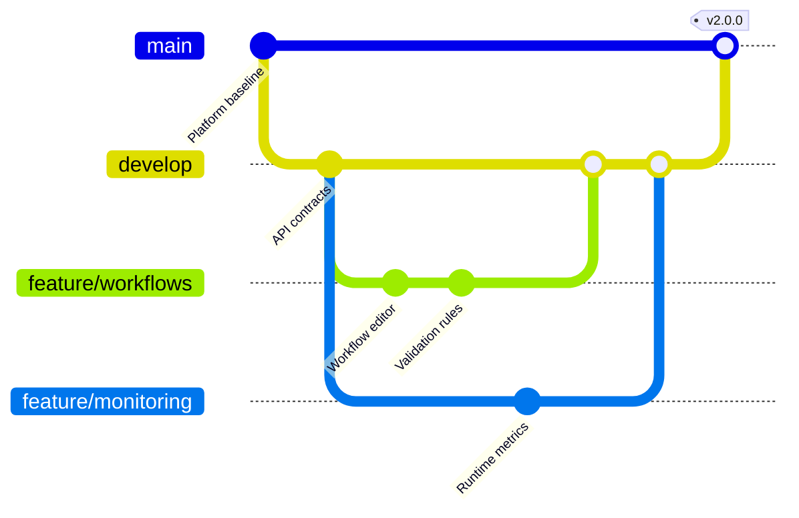

## Git graph: branches, commits, and merges

**Atlas example 11 of 44**

Use a Git graph to explain a branching strategy, parallel feature work, releases, and integration points.

### Core Mermaid elements
- gitGraph starts the history.
- commit id: "..." adds a named commit.
- branch creates a branch; checkout selects it.
- merge joins histories; tag marks a release.

### Build it well
1. Start from a simple baseline.
2. Show only branches needed for the lesson.
3. Name commits by outcome.
4. Use tags for meaningful release points.

> This is a teaching view of history, not a replacement for the repository log.

<!-- ds-course-column:2 type=markdown -->

## Working example

Use the chart controls to zoom, fit, open fullscreen, or inspect the exact source.
