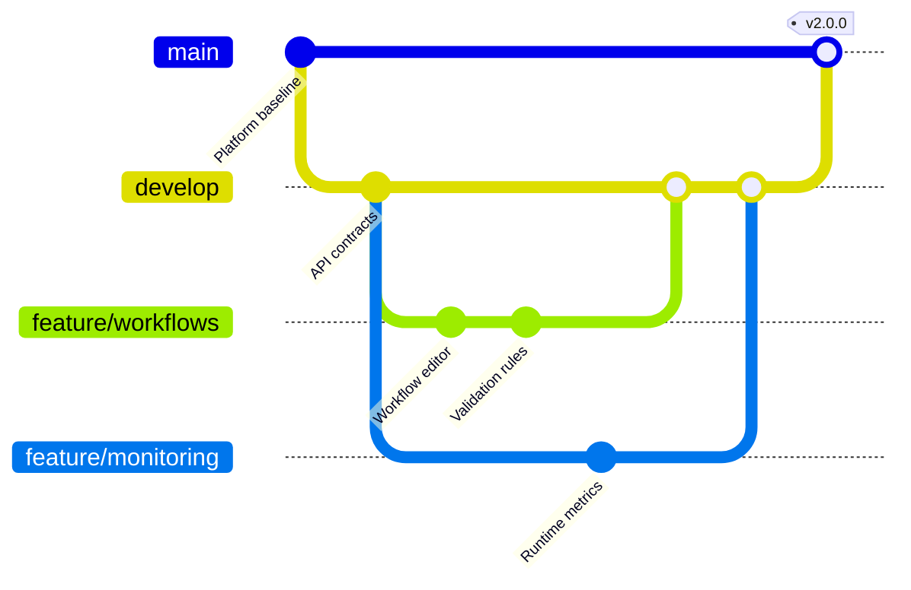

## Mermaid source

```text
gitGraph
  commit id: "Platform baseline"
  branch develop
  checkout develop
  commit id: "API contracts"
  branch feature/workflows
  checkout feature/workflows
  commit id: "Workflow editor"
  commit id: "Validation rules"
  checkout develop
  branch feature/monitoring
  checkout feature/monitoring
  commit id: "Runtime metrics"
  checkout develop
  merge feature/workflows
  merge feature/monitoring
  checkout main
  merge develop tag: "v2.0.0"
```

Change one line at a time, then compare the rendered result on the right.

<!-- ds-course-column:2 type=markdown -->

## Rendered result



Use zoom, fit, fullscreen, and source controls when the diagram is dense.
