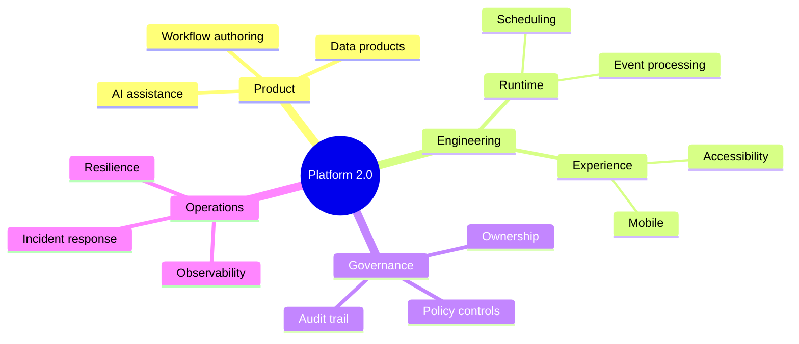

## Mind map: ideas and hierarchy

**Atlas example 12 of 44**

Use a mind map to explore a topic from one central idea into themes, subtopics, and details.

### Core Mermaid elements
- mindmap starts the chart.
- root((Label)) creates the central concept.
- Indentation defines parent and child relationships.
- Deeper indentation adds another level of detail.

### Build it well
1. Use one clear root.
2. Keep sibling labels at the same conceptual level.
3. Stop before the tree becomes a catalogue.
4. Reorganize branches when one grows much larger than the others.

> Mind maps support exploration; tree views support literal hierarchy.

<!-- ds-course-column:2 type=markdown -->

## Working example

Use the chart controls to zoom, fit, open fullscreen, or inspect the exact source.
