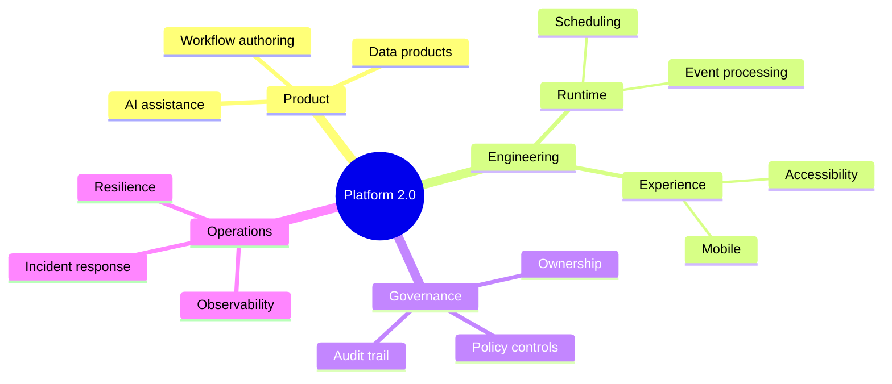

## Mermaid source

```text
mindmap
  root((Platform 2.0))
    Product
      Workflow authoring
      Data products
      AI assistance
    Engineering
      Runtime
        Scheduling
        Event processing
      Experience
        Accessibility
        Mobile
    Governance
      Ownership
      Policy controls
      Audit trail
    Operations
      Observability
      Resilience
      Incident response
```

Change one line at a time, then compare the rendered result on the right.

<!-- ds-course-column:2 type=markdown -->

## Rendered result



Use zoom, fit, fullscreen, and source controls when the diagram is dense.
