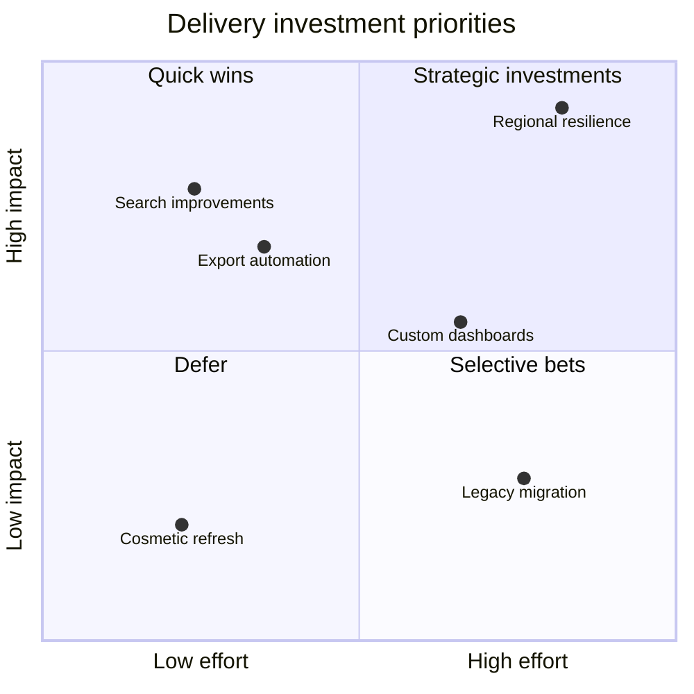

## Quadrant chart: position by two dimensions

**Atlas example 13 of 44**

Use a quadrant chart to compare options across two independent scales such as effort and impact.

### Core Mermaid elements
- quadrantChart starts the chart; title provides the decision context.
- x-axis and y-axis define the low and high ends.
- quadrant-1 through quadrant-4 label the regions.
- Item: [x, y] places a point using values from 0 to 1.

### Build it well
1. Define axes so higher is not automatically better on both.
2. Use comparable evidence for every point.
3. Name quadrants as decisions or interpretations.
4. Avoid false precision in coordinates.

> The value comes from the conversation about placement, not the exact decimals.

<!-- ds-course-column:2 type=markdown -->

## Working example

Use the chart controls to zoom, fit, open fullscreen, or inspect the exact source.
