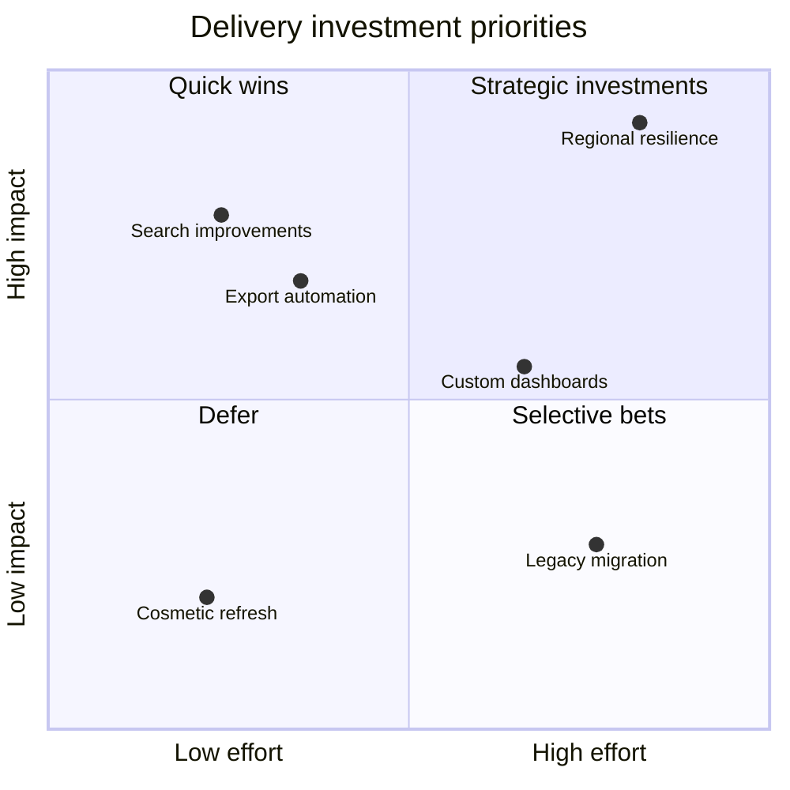

## Mermaid source

```text
quadrantChart
  title Delivery investment priorities
  x-axis Low effort --> High effort
  y-axis Low impact --> High impact
  quadrant-1 Strategic investments
  quadrant-2 Quick wins
  quadrant-3 Defer
  quadrant-4 Selective bets
  Search improvements: [0.24, 0.78]
  Export automation: [0.35, 0.68]
  Regional resilience: [0.82, 0.92]
  Custom dashboards: [0.66, 0.55]
  Legacy migration: [0.76, 0.28]
  Cosmetic refresh: [0.22, 0.20]
```

Change one line at a time, then compare the rendered result on the right.

<!-- ds-course-column:2 type=markdown -->

## Rendered result



Use zoom, fit, fullscreen, and source controls when the diagram is dense.
