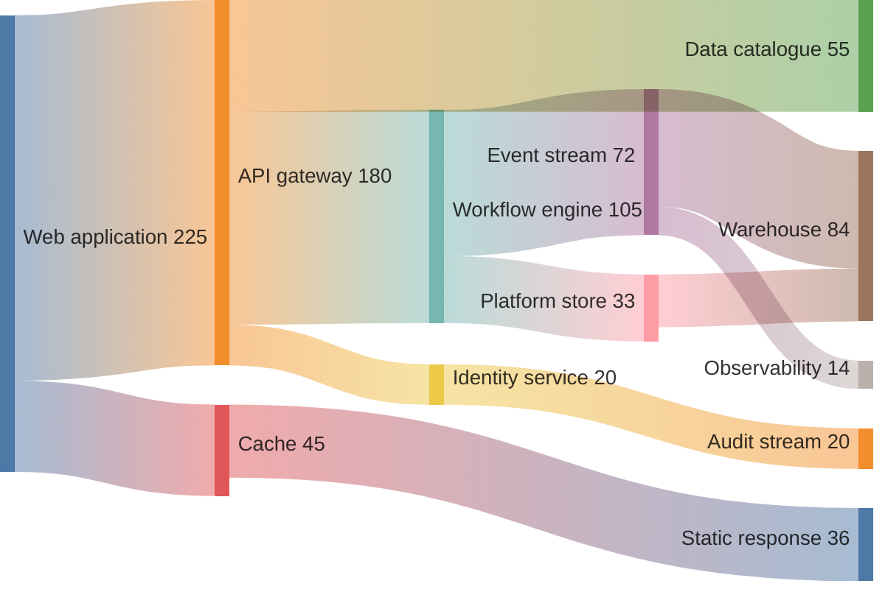

## Sankey diagram: weighted flows

**Atlas example 14 of 44**

Use a Sankey diagram to show how volume moves from sources through transformations to destinations.

### Core Mermaid elements
- sankey-beta starts the chart.
- Each CSV row is source,target,value.
- Repeated names become the same node automatically.
- The numeric value controls the width of the flow.

### Build it well
1. Use consistent units for every row.
2. Ensure outgoing and incoming values make sense.
3. Keep node names stable across rows.
4. Reduce minor flows when they obscure the dominant story.

> A Sankey answers where volume goes and how much, not merely what connects.

<!-- ds-course-column:2 type=markdown -->

## Working example

Use the chart controls to zoom, fit, open fullscreen, or inspect the exact source.
