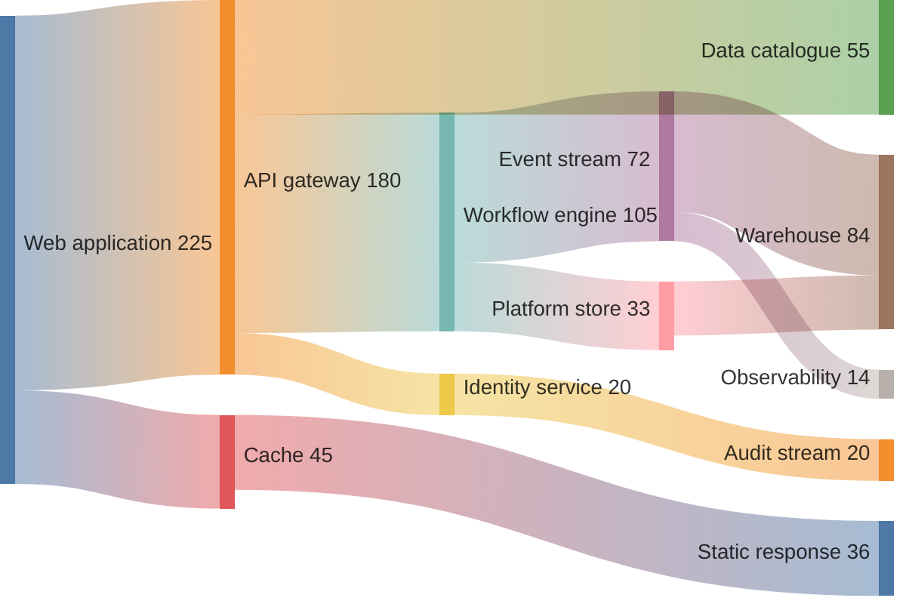

## Mermaid source

```text
sankey-beta
Web application,API gateway,180
Web application,Cache,45
API gateway,Workflow engine,105
API gateway,Data catalogue,55
API gateway,Identity service,20
Workflow engine,Event stream,72
Workflow engine,Platform store,33
Event stream,Warehouse,58
Event stream,Observability,14
Cache,Static response,36
Identity service,Audit stream,20
Platform store,Warehouse,26
```

Change one line at a time, then compare the rendered result on the right.

<!-- ds-course-column:2 type=markdown -->

## Rendered result



Use zoom, fit, fullscreen, and source controls when the diagram is dense.
