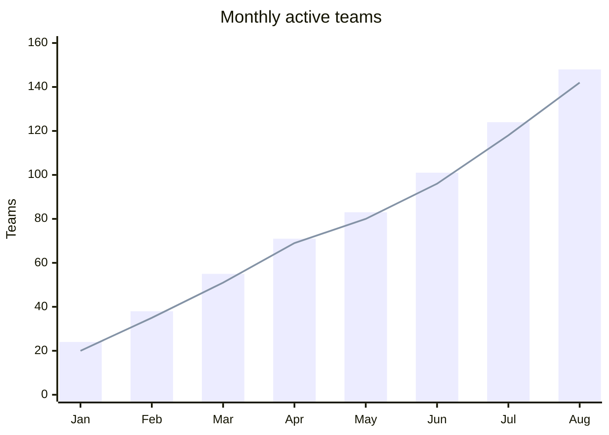

## XY chart: bars, lines, and comparable series

**Atlas example 15 of 44**

Use an XY chart for ordered categories or time periods where exact comparison and trend are important.

### Core Mermaid elements
- xychart-beta starts the chart.
- x-axis [A, B, C] defines categories.
- y-axis "Label" min --> max defines the scale.
- bar [...] and line [...] add series; each series must match the x-axis length.

### Build it well
1. Choose a truthful y-axis range.
2. Keep category order meaningful.
3. Use bars for magnitude and lines for trend.
4. Do not mix incompatible units on one axis.

> When the data is the message, prefer XY over decorative chart forms.

<!-- ds-course-column:2 type=markdown -->

## Working example

Use the chart controls to zoom, fit, open fullscreen, or inspect the exact source.
