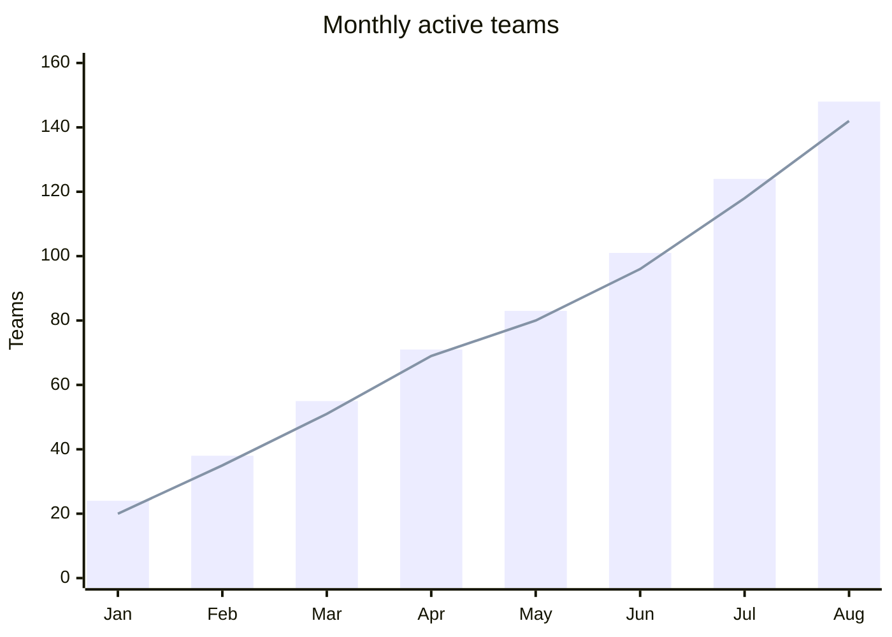

## Mermaid source

```text
xychart-beta
  title "Monthly active teams"
  x-axis [Jan, Feb, Mar, Apr, May, Jun, Jul, Aug]
  y-axis "Teams" 0 --> 160
  bar [24, 38, 55, 71, 83, 101, 124, 148]
  line [20, 35, 51, 69, 80, 96, 118, 142]
```

Change one line at a time, then compare the rendered result on the right.

<!-- ds-course-column:2 type=markdown -->

## Rendered result



Use zoom, fit, fullscreen, and source controls when the diagram is dense.
