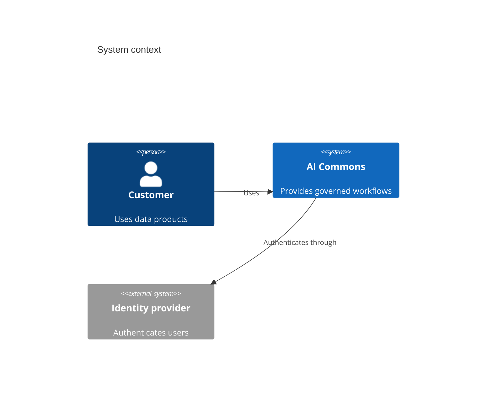

## C4 context: people, system, and external dependencies

**Atlas example 16 of 44**

Use a C4 context diagram to establish the system boundary, its users, and the external systems it depends on.

### Core Mermaid elements
- C4Context selects the highest C4 level.
- Person defines a human role; System defines the system in scope.
- System_Ext marks an external dependency.
- Rel(source, target, "label") describes a directional relationship.

### Build it well
1. Place the system in scope at the center of the story.
2. Name user roles by responsibility.
3. Include only direct external dependencies.
4. Describe relationships with business-relevant verbs.

> Context answers who uses the system and what surrounds it, not how it is built.

<!-- ds-course-column:2 type=markdown -->

## Working example

Use the chart controls to zoom, fit, open fullscreen, or inspect the exact source.
