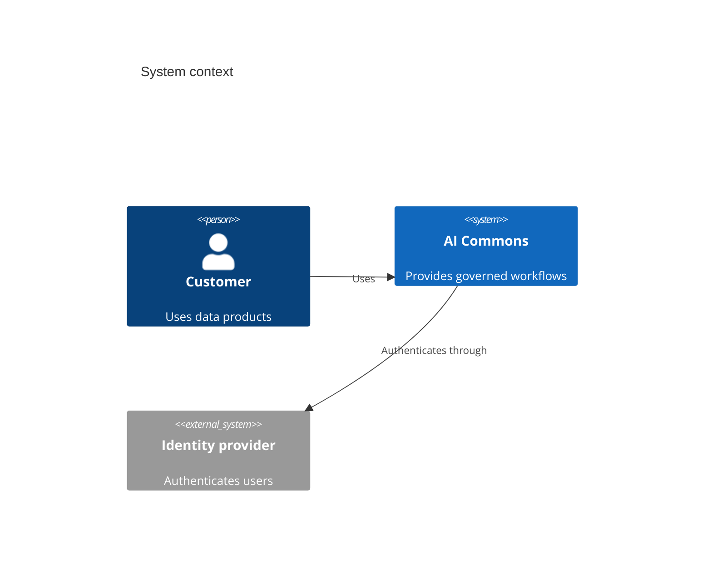

## Mermaid source

```text
C4Context
  title System context
  Person(customer, "Customer", "Uses data products")
  System(portal, "AI Commons", "Provides governed workflows")
  System_Ext(identity, "Identity provider", "Authenticates users")
  Rel(customer, portal, "Uses")
  Rel(portal, identity, "Authenticates through")
```

Change one line at a time, then compare the rendered result on the right.

<!-- ds-course-column:2 type=markdown -->

## Rendered result



Use zoom, fit, fullscreen, and source controls when the diagram is dense.
