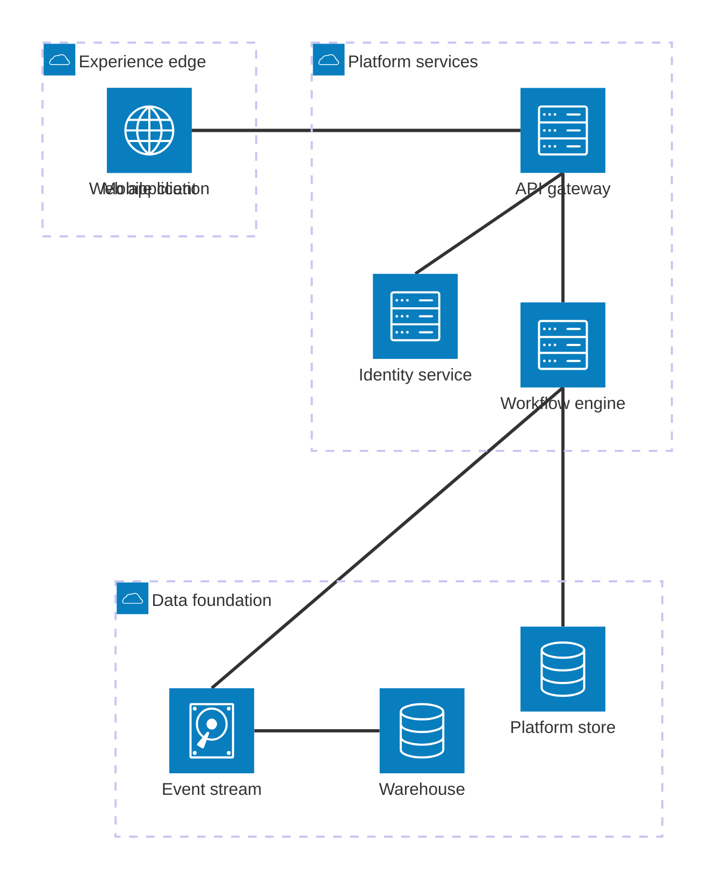

## Architecture diagram: services, groups, and ports

**Atlas example 17 of 44**

Use an architecture diagram to show deployment or service groupings together with directional connections.

### Core Mermaid elements
- architecture-beta starts the diagram.
- group id(icon)[Label] creates a boundary.
- service id(icon)[Label] in group places a service.
- service:R -- L:target connects explicit right and left ports; T and B address top and bottom.

### Build it well
1. Create groups before their services.
2. Choose icons that reinforce the service role.
3. Route connections through sensible sides.
4. Keep the topology focused on one architectural question.

> Explicit ports make dense service maps easier to read than generic arrows.

<!-- ds-course-column:2 type=markdown -->

## Working example

Use the chart controls to zoom, fit, open fullscreen, or inspect the exact source.
