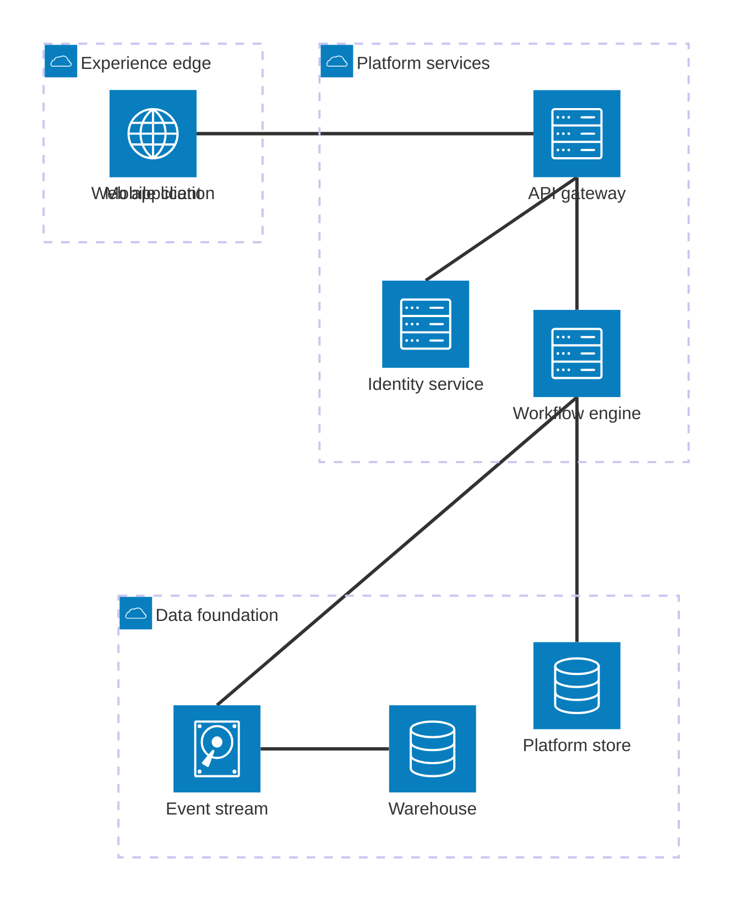

## Mermaid source

```text
architecture-beta
  group edge(cloud)[Experience edge]
  group platform(cloud)[Platform services]
  group data(cloud)[Data foundation]
  service web(internet)[Web application] in edge
  service mobile(internet)[Mobile client] in edge
  service api(server)[API gateway] in platform
  service identity(server)[Identity service] in platform
  service workflow(server)[Workflow engine] in platform
  service events(disk)[Event stream] in data
  service store(database)[Platform store] in data
  service warehouse(database)[Warehouse] in data
  web:R -- L:api
  mobile:R -- L:api
  api:B -- T:identity
  api:B -- T:workflow
  workflow:B -- T:events
  workflow:B -- T:store
  events:R -- L:warehouse
```

Change one line at a time, then compare the rendered result on the right.

<!-- ds-course-column:2 type=markdown -->

## Rendered result



Use zoom, fit, fullscreen, and source controls when the diagram is dense.
