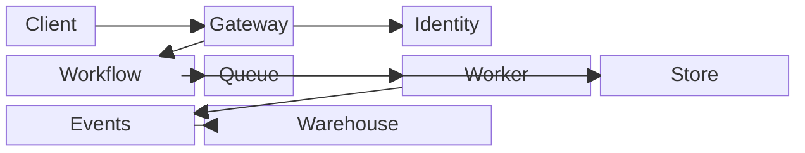

## Block diagram: controlled grid composition

**Atlas example 18 of 44**

Use a block diagram when exact relative placement and visual grouping matter more than semantic node shapes.

### Core Mermaid elements
- block-beta starts the diagram.
- columns N defines the grid.
- Label or Id["Label"] adds a block; :2 makes it span two columns.
- A --> B connects blocks after placement.

### Build it well
1. Choose the grid width first.
2. Use spans to communicate importance or grouping.
3. Place related blocks near one another.
4. Add arrows only after the layout is understandable.

> Block diagrams trade automatic layout for deliberate composition.

<!-- ds-course-column:2 type=markdown -->

## Working example

Use the chart controls to zoom, fit, open fullscreen, or inspect the exact source.
