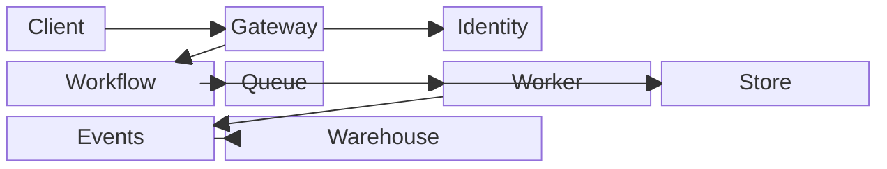

## Mermaid source

```text
block-beta
  columns 7
  Client space Gateway space Identity space:2
  Workflow:2 Queue space Worker:2
  Store:2 Events:2 Warehouse:3
  Client --> Gateway
  Gateway --> Identity
  Gateway --> Workflow
  Workflow --> Queue
  Queue --> Worker
  Workflow --> Store
  Worker --> Events
  Events --> Warehouse
```

Change one line at a time, then compare the rendered result on the right.

<!-- ds-course-column:2 type=markdown -->

## Rendered result



Use zoom, fit, fullscreen, and source controls when the diagram is dense.
