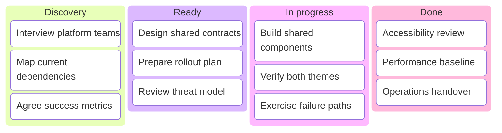

## Kanban board: work by status

**Atlas example 19 of 44**

Use a Kanban diagram to show work items grouped by workflow state at one moment in time.

### Core Mermaid elements
- kanban starts the board.
- columnId[Label] creates a column.
- Indented taskId[Label] creates a card in that column.
- The source order controls column and card order.

### Build it well
1. Use real workflow states.
2. Keep card labels actionable and short.
3. Limit work in the active column.
4. Treat the chart as a snapshot, not a live board.

> Kanban shows where work is now; Gantt shows when work is planned.

<!-- ds-course-column:2 type=markdown -->

## Working example

Use the chart controls to zoom, fit, open fullscreen, or inspect the exact source.
