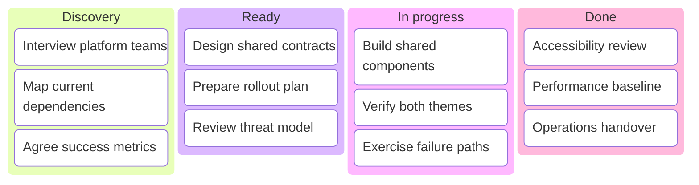

## Mermaid source

```text
kanban
  discovery[Discovery]
    task1[Interview platform teams]
    task2[Map current dependencies]
    task3[Agree success metrics]
  ready[Ready]
    task4[Design shared contracts]
    task5[Prepare rollout plan]
    task6[Review threat model]
  active[In progress]
    task7[Build shared components]
    task8[Verify both themes]
    task9[Exercise failure paths]
  completed[Done]
    task10[Accessibility review]
    task11[Performance baseline]
    task12[Operations handover]
```

Change one line at a time, then compare the rendered result on the right.

<!-- ds-course-column:2 type=markdown -->

## Rendered result



Use zoom, fit, fullscreen, and source controls when the diagram is dense.
